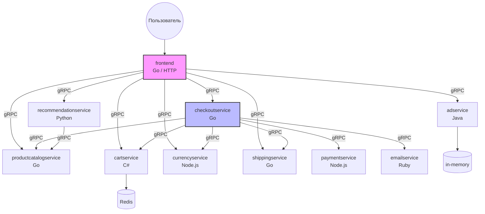

# Практическая работа №5
## Тема: Документирование систем с микросервисной архитектурой

**Дисциплина:** Микросервисная архитектура
**Объём:** 2 академических часа (+ самостоятельная работа)
**Формируемая компетенция:** ПК-4
**Целевой проект:** [GoogleCloudPlatform / microservices-demo (Online Boutique)](https://github.com/GoogleCloudPlatform/microservices-demo)

---

## 1. Цель работы

Получить практические навыки анализа, создания и оформления документации для реального проекта с микросервисной архитектурой. На примере открытого проекта **Online Boutique** (эталонное интернет-приложение с 11 микросервисами) научиться:

- анализировать существующую документацию и выявлять её пробелы;
- составлять README сервиса по стандартному шаблону;
- описывать API-контракты (OpenAPI / AsyncAPI / gRPC);
- фиксировать архитектурные решения в формате ADR;
- формировать Runbook для эксплуатации;
- визуализировать архитектуру с помощью модели C4 (диаграммы в формате Mermaid).

---

## 2. Характеристика целевого проекта

**Online Boutique** — демонстрационное веб-приложение интернет-магазина, развёрнутое в Kubernetes.

| Параметр | Значение |
|---|---|
| Количество сервисов | 11 |
| Языки программирования | Go, Python, C#, Java, Node.js, Ruby |
| Протоколы взаимодействия | gRPC, HTTP/REST |
| Оркестрация | Kubernetes |
| Брокер сообщений | отсутствует (синхронные gRPC-вызовы) |
| Лицензия | Apache 2.0 |

### Перечень сервисов проекта

| № | Сервис | Язык | Назначение |
|---|---|---|---|
| 1 | `frontend` | Go | Веб-интерфейс, агрегация вызовов |
| 2 | `cartservice` | C# | Управление корзиной |
| 3 | `productcatalogservice` | Go | Каталог товаров |
| 4 | `currencyservice` | Node.js | Конвертация валют |
| 5 | `paymentservice` | Node.js | Обработка платежей |
| 6 | `shippingservice` | Go | Расчёт стоимости доставки |
| 7 | `emailservice` | Ruby | Отправка уведомлений по e-mail |
| 8 | `checkoutservice` | Go | Оформление заказа (оркестрация) |
| 9 | `recommendationservice` | Python | Рекомендации товаров |
| 10 | `adservice` | Java | Рекламные баннеры |
| 11 | `loadgenerator` | Python | Генерация тестовой нагрузки |

---

## 3. Предварительные требования

Перед началом работы необходимо:

- Установленный **Git**, **Docker**, **docker-compose** (или доступ к GitHub через браузер);
- Аккаунт на [github.com](https://github.com);
- Любой текстовый редактор с поддержкой Markdown (VS Code, Typora, Obsidian);
- Знакомство с материалами **Лекции 6** «Документирование систем с МСА».

### Клонирование проекта

```bash
git clone https://github.com/GoogleCloudPlatform/microservices-demo.git
cd microservices-demo
```

### Изучение структуры репозитория

```
microservices-demo/
├── src/
│   ├── frontend/
│   ├── cartservice/
│   ├── productcatalogservice/
│   ├── currencyservice/
│   ├── paymentservice/
│   ├── shippingservice/
│   ├── emailservice/
│   ├── checkoutservice/
│   ├── recommendationservice/
│   ├── adservice/
│   └── loadgenerator/
├── kubernetes-manifests/
├── helm-chart/
├── docs/
├── README.md
└── .github/
```

---

## 4. Задания практической работы

### Задание 1. Аудит существующей документации (аудиторно, 20 мин)

**Цель:** оценить полноту и качество документации проекта по модели Diátaxis.

**Порядок выполнения:**

1. Откройте `README.md` в корне репозитория и папку `docs/`.
2. Пройдите по документации каждого сервиса в `src/<сервис>/`.
3. Заполните таблицу аудита:

| Критерий | Есть / Нет | Качество (1–5) | Комментарий |
|---|---|---|---|
| Общее описание проекта | | | |
| Диаграмма архитектуры | | | |
| Инструкции по локальному запуску | | | |
| Инструкции по развёртыванию в K8s | | | |
| README для каждого сервиса | | | |
| Спецификация API (OpenAPI / proto) | | | |
| Описание конфигурации (переменные окружения) | | | |
| ADR или описание архитектурных решений | | | |
| Runbook / troubleshooting | | | |
| Changelog | | | |

**Контрольный вопрос:** Какие разделы отсутствуют или недостаточно раскрыты? Составьте список из **не менее 5** выявленных пробелов.

---

### Задание 2. Составление README для выбранного сервиса (аудиторно, 25 мин)

**Цель:** научиться создавать стандартизированную документацию сервиса.

**Порядок выполнения:**

1. Выберите **один** сервис по указанию преподавателя (или самостоятельно). Рекомендуемые варианты:
   - **Вариант А:** `checkoutservice` (Go) — оркестрация оформления заказа;
   - **Вариант Б:** `cartservice` (C#) — работа с внешним хранилищем (Redis);
   - **Вариант В:** `recommendationservice` (Python) — зависимость от другого сервиса.

2. Изучите исходный код выбранного сервиса:
   - файл `Dockerfile`;
   - основной файл приложения;
   - файлы конфигурации;
   - `.proto` файлы (если применимо).

3. Создайте файл `README_STUDENT.md` в корне выбранного сервиса по шаблону:

```markdown
# <название сервиса>

## Описание
(1–2 абзаца: назначение, бизнес-роль в системе)

## Архитектурная роль
(Место в общей архитектуре. Ссылка на диаграмму)

## Быстрый старт
### Требования
- ...
### Запуск локально
```bash
...
```
### Запуск через Docker
```bash
...
```

## API / Интерфейсы
(Перечень gRPC-методов или REST-эндпоинтов с кратким описанием)

## Зависимости
| Зависимость | Тип | Назначение |
|---|---|---|
| ... | ... | ... |

## Конфигурация
| Переменная | Назначение | По умолчанию | Обязательная |
|---|---|---|---|
| ... | ... | ... | ... |

## Тестирование
(Как запустить тесты)

## Контакты
(Команда-владелец)
```

**Контрольный вопрос:** Какие разделы вызвали наибольшие затруднения и почему?

---

### Задание 3. Описание API-контрактов (аудиторно, 20 мин)

**Цель:** зафиксировать контракт взаимодействия сервисов.

**Порядок выполнения:**

1. Найдите `.proto` файлы в выбранном сервисе (например, `proto/demo.proto` в корне репозитория).
2. Выделите **все gRPC-сервисы и методы**, относящиеся к вашему сервису.
3. Оформите таблицу контрактов:

| Сервис (gRPC) | Метод | Запрос (тип) | Ответ (тип) | Вызывающий сервис |
|---|---|---|---|---|
| `CheckoutService` | `PlaceOrder` | `PlaceOrderRequest` | `PlaceOrderResponse` | `frontend` |
| `CartService` | `AddItem` | `AddItemRequest` | `Empty` | `frontend` |
| ... | ... | ... | ... | ... |

4. Для **одного** метода составьте текстовое описание в стиле OpenAPI:

```yaml
# Эквивалент OpenAPI для gRPC-метода PlaceOrder
paths:
  /checkout:
    post:
      summary: Оформление заказа
      operationId: placeOrder
      requestBody:
        required: true
        content:
          application/json:
            schema:
              type: object
              properties:
                userId:
                  type: string
                userCurrency:
                  type: string
                address:
                  $ref: '#/components/schemas/Address'
                email:
                  type: string
                creditCard:
                  $ref: '#/components/schemas/CreditCardInfo'
      responses:
        '200':
          description: Заказ успешно оформлен
          content:
            application/json:
              schema:
                type: object
                properties:
                  order:
                    $ref: '#/components/schemas/OrderResult'
```

**Контрольный вопрос:** Чем отличается подход к документированию синхронного gRPC-вызова от асинхронного сообщения в брокере?

---

### Задание 4. Диаграмма архитектуры в модели C4 (самостоятельно, 30 мин)

**Цель:** визуализировать архитектуру проекта на уровнях Context и Container.

**Порядок выполнения:**

1. Составьте диаграмму **уровня 1 (Context)** — система как единое целое и внешние акторы.
2. Составьте диаграмму **уровня 2 (Container)** — все 11 сервисов, протоколы взаимодействия, хранилища данных.
3. Оформите в формате **Mermaid** (рендеринг: [mermaid.live](https://mermaid.live)).

**Пример заготовки (уровень Container, неполный):**



4. Добавьте диаграмму в файл `README_STUDENT.md` в раздел «Архитектурная роль».

**Контрольный вопрос:** Какие сервисы являются критическими точками отказа (Single Point of Failure)?

---

### Задание 5. Запись ADR (самостоятельно, 20 мин)

**Цель:** зафиксировать и обосновать архитектурное решение проекта.

**Порядок выполнения:**

1. Проанализируйте исходный код `checkoutservice` и определите, какой паттерн оркестрации используется при оформлении заказа.
2. Оформите ADR по шаблону:

```markdown
# ADR-001: <Тема решения>

## Статус
Принято

## Контекст
(Описание проблемы. Почему возникла необходимость в решении?)

## Решение
(Что именно сделано? Какой паттерн / технология выбраны?)

## Альтернативы
(Какие другие варианты рассматривались? Почему отклонены?)

## Последствия
- (+) Положительные
- (−) Отрицательные / риски
```

**Примеры тем для ADR (на выбор):**

| № | Тема |
|---|---|
| 1 | Почему выбран gRPC вместо REST для межсервисного взаимодействия |
| 2 | Почему `cartservice` использует Redis, а не собственную БД |
| 3 | Почему `checkoutservice` реализует оркестрацию, а не хореографию |
| 4 | Почему выбраны разные языки программирования для разных сервисов |
| 5 | Почему отсутствует брокер сообщений (полностью синхронная архитектура) |

**Контрольный вопрос:** Какие риски несёт полностью синхронная архитектура (без брокера сообщений) при отказе одного из сервисов?

---

### Задание 6. Составление Runbook (самостоятельно, 25 мин)

**Цель:** создать операционную документацию для инженера эксплуатации.

**Порядок выполнения:**

1. Изучите `kubernetes-manifests/` выбранного сервиса.
2. Определите:
   - ресурсы (CPU / RAM limits);
   - переменные окружения;
   - health-checks (liveness / readiness probes);
   - порты и сервисные имена в кластере.
3. Составьте Runbook по шаблону:

```markdown
# Runbook: <название сервиса>

## Обзор
Назначение, критичность для бизнес-процесса.

## Метрики и алерты
| Метрика | Порог | Действие |
|---|---|---|
| ... | ... | ... |

## Типовые инциденты

### Инцидент 1: Сервис не запускается (CrashLoopBackOff)
**Симптомы:** ...
**Диагностика:**
1. `kubectl logs deployment/<имя> -n <namespace>`
2. `kubectl describe pod <pod-name>`
**Решение:** ...
**Эскалация:** ...

### Инцидент 2: Высокая задержка ответов
...

### Инцидент 3: Отказ зависимости (например, Redis для cartservice)
...

## Контакты эскалации
| Уровень | Команда | Канал |
|---|---|---|
| L1 | Дежурный SRE | #oncall |
| L2 | Команда сервиса | #team-... |
```

**Контрольный вопрос:** Какие действия должен предпринять инженер, если `cartservice` не может подключиться к Redis? Опишите пошагово.

---

## 5. Сводная таблица заданий

| № | Задание | Форма работы | Время | Результат |
|---|---|---|---|---|
| 1 | Аудит документации проекта | Аудиторно | 20 мин | Таблица аудита + список пробелов |
| 2 | README для сервиса | Аудиторно | 25 мин | Файл `README_STUDENT.md` |
| 3 | Описание API-контрактов | Аудиторно | 20 мин | Таблица контрактов + YAML-описание |
| 4 | Диаграмма C4 (Mermaid) | Самостоятельно | 30 мин | Диаграммы Context + Container |
| 5 | Запись ADR | Самостоятельно | 20 мин | Файл `ADR-001.md` |
| 6 | Составление Runbook | Самостоятельно | 25 мин | Файл `RUNBOOK.md` |

---

## 6. Требования к отчёту

Отчёт предоставляется в виде **одного архива** (`.zip`) или **ссылки на репозиторий** со следующей структурой:

```
practice-5-report/
├── 1-audit/
│   └── audit-table.md          # Задание 1
├── 2-readme/
│   └── README_STUDENT.md       # Задание 2
├── 3-api/
│   └── api-contracts.md        # Задание 3
├── 4-architecture/
│   ├── c4-context.mmd          # Задание 4 (уровень Context)
│   └── c4-container.mmd        # Задание 4 (уровень Container)
├── 5-adr/
│   └── ADR-001.md              # Задание 5
├── 6-runbook/
│   └── RUNBOOK.md              # Задание 6
└── README.md                   # Титульный лист: ФИО, группа, вариант
```

---

## 7. Критерии оценивания

| Критерий | Баллы | Описание |
|---|---|---|
| Полнота выполнения всех 6 заданий | 0–20 | По 3 балла за задание + 2 за оформление |
| Качество анализа исходного кода | 0–20 | Корректность извлечённой информации |
| Соответствие шаблонам | 0–15 | README, ADR, Runbook по заданным шаблонам |
| Качество диаграмм C4 | 0–15 | Полнота, корректность связей, читаемость |
| Обоснованность выводов | 0–15 | Аргументация в ADR, выявленные пробелы |
| Ответы на контрольные вопросы | 0–15 | Полнота и точность ответов |
| **Итого** | **100** | |

### Шкала перевода

| Баллы | Оценка |
|---|---|
| 90–100 | Отлично (5) |
| 75–89 | Хорошо (4) |
| 60–74 | Удовлетворительно (3) |
| 0–59 | Неудовлетворительно (2) |

---

## 8. Альтернативные проекты для выполнения

При необходимости преподаватель может назначить другой открытый проект:

| Проект | Ссылка | Особенности |
|---|---|---|
| **Sock Shop** | [github.com/microservices-demo/microservices-demo](https://github.com/microservices-demo/microservices-demo) | Классический пример, 8 сервисов |
| **eShop** (.NET) | [github.com/dotnet/eShop](https://github.com/dotnet/eShop) | Паттерны CQRS, Event Bus, DDD |
| **Robot Shop** | [github.com/instana/robot-shop](https://github.com/instana/robot-shop) | 8 сервисов, фокус на мониторинге |
| **Train Schedule** | [github.com/pixiegarden/microservice-demo](https://github.com/pixiegarden/microservice-demo) | Простой пример для начинающих |

При использовании альтернативного проекта структура отчёта и критерии оценивания сохраняются.

---

## 9. Рекомендуемые источники

1. Лекция 6: «Документирование систем с МСА».
2. Документация проекта: [github.com/GoogleCloudPlatform/microservices-demo](https://github.com/GoogleCloudPlatform/microservices-demo)
3. Diátaxis Framework: [diataxis.fr](https://diataxis.fr/)
4. C4 Model: [c4model.com](https://c4model.com/)
5. Mermaid Syntax: [mermaid.js.org](https://mermaid.js.org/)
6. OpenAPI Specification: [spec.openapis.org](https://spec.openapis.org/oas/v3.1.0)
7. gRPC Documentation: [grpc.io/docs](https://grpc.io/docs/)
8. Richardson C. *Microservices Patterns.* Manning, 2018. — Ch. 11, 12.

---

*Конец практической работы №5.*
*Следующая практическая работа (№6): Миграция систем, разработанных в монолитной архитектуре, на МСА.*